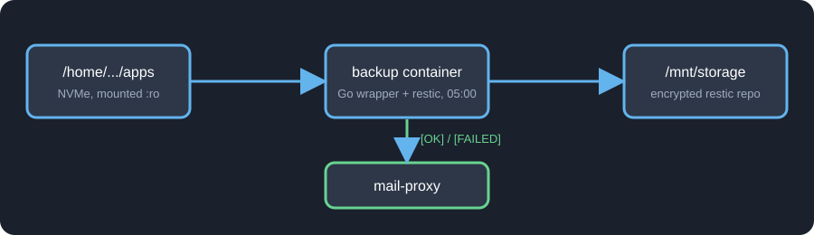

import Note from "@components/Note.astro";
import GitHubLink from "@components/GitHubLink.astro";

<GitHubLink owner="addun" repository="homelab" />

## The problem

Every service in the home lab lives in its own folder under `~/apps`: a `docker-compose.yml`, an `.env` and the data that the container writes. Immich, Home Assistant, Jellyfin, Grafana, Authelia, AdGuard Home - all of them follow the same layout, which I described in the [earlier parts of this series](/blog/Kq7Bv3).

That is convenient, but it also means one dead SSD takes the whole lab with it - and the photos in Immich are the only copy of them. A backup that was never restored is only a hope, so this post covers both the nightly copy and the proof that it works.

What I want from a backup:

- **Automatic**
- **On a different disk** than the data
- **Encrypted and deduplicated** - ensuring that the backup is secure and doesn't waste space on repeated data
- **Warns when it breaks**
- **Automated restore** - at some point something has to actually restore the data and check it.

## Potential solutions

Plain `rsync` to the other disk is the first thing that comes to mind.
It copies the files, but it keeps only one version: if a config gets corrupted on Monday, the corrupted file is synced over the good one on Tuesday.

I looked at the usual candidates - [BorgBackup](https://www.borgbackup.org/), [Kopia](https://kopia.io/) and [restic](https://restic.net/) - and picked restic, because:

- It is a **single static binary** and it is in the Alpine repositories, so the container image stays tiny.
- Every snapshot is **encrypted** with a password, which matters the day the repository gets copied somewhere off-site.
- Data is **deduplicated** in chunks, so the second night costs almost nothing.
- It can **verify itself** (`restic check`) and **restore** (`restic restore --verify`).

What restic doesn't do is scheduling, mail notifications or any opinion about what "a successful backup" means. That part is a small wrapper, and it is the interesting one.

## The architecture



There is one container called `backup`. It:

1. Wakes up every day at 05:00.
2. Runs `restic backup` on the whole `apps` folder (mounted **read-only**).
3. Applies the retention policy.
4. Checks the repository, including a random sample of the actual data.
5. Sends an `[OK]` or `[FAILED]` e-mail through the same `mail-proxy` container that [WUD](/blog/PdG1BO) already uses.
6. On the 1st of every month - restores the newest snapshot and checks that the result makes sense.

The repository is on `/mnt/storage`, which is the second physical disk, while `apps` is on the NVMe drive.

## The setup

Following the usual convention, the backup gets its own folder with its own `docker-compose.yml`:

```yaml
services:
  backup:
    build:
      context: ./app
    container_name: backup
    restart: unless-stopped
    env_file:
      - .env
    environment:
      - TZ=Europe/Warsaw
      - RESTIC_REPOSITORY=/repo
      - RESTIC_CACHE_DIR=/cache
      - RUN_AT=05:00
      - MAIL_HOST=mail-proxy
      - MAIL_PORT=25
      - MAIL_FROM=${MAIL_FROM}
      - MAIL_TO=${MAIL_TO}
    volumes:
      - /home/greenserver/apps:/apps:ro
      - /mnt/storage/backups/restic:/repo
      - /mnt/storage/backups/restore-test:/restore
      - ./cache:/cache
    networks:
      - email

networks:
  email:
    name: email
```

and a `.env` with three values:

```bash
MAIL_TO=
MAIL_FROM=
RESTIC_PASSWORD=
```

Few things worth to mention:

- `/apps` is mounted with `:ro`. The backup can read everything and can't change anything - a bug in my wrapper can't damage the data it protects.
- The repository and the restore directory are two separate folders on the backup disk.
- The `email` network is how the container reaches `mail-proxy`, so there is no SMTP server in this stack.
- `./cache` is restic's cache. It speeds up runs, it's in `.gitignore` and it's excluded from the backup itself.

<Note type="CRITICAL">
  Keep `RESTIC_PASSWORD` somewhere **outside** the server - a password manager is enough. Without the password the
  repository is just random bytes, and if the password lives only in the `.env` on the machine that just died, the
  backup died with it.
</Note>

## What the wrapper does

`restic` only does the backup itself. Everything around it is done by a small wrapper program that is the main process of the container. It:

- **Schedules the run.** It sleeps until `RUN_AT` in the configured time zone, runs the backup and goes back to sleep until the next day.
- **Runs the whole sequence.** Initialises the repository on the first run, then backup, retention and integrity check, one after another. It stops at the first step that fails.
- **Reports every run by e-mail.** One `[OK]` or `[FAILED]` mail per run, and a failed one says which step broke.
- **Doesn't run twice at once.** If a scheduled run and a manual one overlap, the second one skips.
- **Separates a warning from a failure.** A snapshot that was created but couldn't read a few files is reported as a warning, not as a failed backup.
- **Runs the restore drill** on the 1st of every month, right after the backup.
- **Can be triggered by hand.** `backup once` takes a snapshot immediately and `backup drill` runs the restore drill immediately. A tiny script wraps the first one for when I want a backup before a risky change:

```bash
#!/usr/bin/env bash
set -euo pipefail

docker exec backup /usr/local/bin/backup once
```

I chose it over a plain cron job because of the mail. A cron job fails silently, and when the container or the cron daemon dies, nothing arrives - which looks exactly like "everything is fine". With the wrapper the daily `[OK]` mail is the heartbeat: when it doesn't arrive, something is wrong.

## What gets backed up

The whole `apps` folder, with a short list of exclusions:

```go
var excludes = []string{
	"some_app_cache_1",
  "some_app_cache_2",
  "..."
}
```

Exclude what you don't care about:

- **Caches** - anything the service rebuilds on its own, including the backup's own cache.
- **Metrics and logs** - useful for a few weeks, not worth the space.
- **Raw database files** - a copy of a running Postgres often can't be restored. Back up a dump instead (more on that below).

What is _not_ excluded is the interesting part: every compose file, every `.env`, every config and the photo library. Rebuilding the lab from the backup means checking out the folder and running `docker compose up -d` in it.

### Databases

Files are easy to back up, a running database is not - but it depends on which one.

**SQLite** is a single file (plus, in WAL mode, a small `-wal` file next to it). Every change is a tiny transaction, and the format is built so that the file is valid after a crash at any moment. A copy taken in the middle of a write looks, to SQLite, like a power cut: on the first open it finishes or rolls back the last transaction and carries on. So a plain file copy of SQLite is good enough, as long as the `-wal` file is copied together with the main file. Many small services (the \*arr apps, for example) keep their data this way, and they need nothing special.

**Postgres** keeps its data in thousands of files, and a file-by-file copy of a running instance takes seconds to minutes. Different files are copied at different moments, so the backup contains a table from one point in time and its index or the write-ahead log from another. That isn't a state the database ever was in, and it isn't a crash it can recover from - the backup looks fine until the day you restore it and Postgres refuses to start or, worse, starts with corrupted data. The same goes for any other server database, like MySQL.

The fix is to back up a **dump**, not the data directory: a consistent export taken by the database itself (`pg_dump`), written to a file that restic then picks up like any other. So the raw Postgres folder goes on the exclude list, and the dump is what lands in the snapshot.

Most self-hosted apps that use Postgres can write such a dump on a schedule. Use that, and set `RUN_AT` **after** it: if the dump is written at 04:00 and the backup runs at 03:00, I'm backing up yesterday's dump. That's why the backup starts at 05:00.

## What one run does

The core of the nightly job is three `restic` calls:

```go
args := []string{"backup", sourceDir, "--tag", "files", "--host", "homelab"}
for _, e := range excludes {
	args = append(args, "--exclude", sourceDir+"/"+e)
}
```

```go
restic("forget", "--prune", "--host", "homelab",
	"--keep-daily", "7", "--keep-weekly", "4", "--keep-monthly", "6")
```

```go
restic("check", "--read-data-subset=2%")
```

- **`backup`** creates a snapshot. `--host homelab` pins the snapshot's host name, because inside a container the host name is a random ID that changes whenever the container is recreated, and restic's retention groups snapshots by host.
- **`forget --prune`** keeps the last 7 daily, 4 weekly and 6 monthly snapshots and removes the rest. That's about half a year of history in a handful of snapshots.
- **`check --read-data-subset=2%`** verifies the structure of the repository and reads a random 2% of the data to verify it. A full read of the repository every night would take too long, but a random 2% gives that every piece gets verified over time.

A few details in the wrapper worth mentioning:

- **A lock file.** If the scheduler and a manual `backup once` start at the same time, they fight over restic's exclusive lock during prune. The second one now sees the lock and skips.
- **Exit code 3 is a warning, not a failure.** It means the snapshot was created but some files couldn't be read - for example a file that disappeared mid-backup. The mail then says so, instead of marking a perfectly usable backup as failed.
- **Every step reports separately.** The `[FAILED]` mail says _which_ step failed (`repo init`, `files backup`, `retention`, `integrity check`) and includes the output of restic.

## The e-mail

After every run I get one of these:

```
Subject: [OK] Homelab backup 2026-11-02

Homelab backup completed successfully.
Duration: 1m3s

== files ==
...
== retention ==
...
== check == ok
```

or `[FAILED] Homelab backup ...` with the failing step and a hint to run `docker logs backup`.

## The restore drill

A backup that has never been restored is a hope, not a backup. Because of that, on the 1st of every month, right after the backup, the same container runs a **restore drill**:

1. Restores the newest snapshot (without the photo library) into `/mnt/storage/backups/restore-test` with `--verify`, so restic re-reads every restored file and compares it with its checksum.
2. Restores only the folder with the database dumps from the library.
3. **Compares the config files.** Every `docker-compose.*` and `.env` of the live tree must exist in the restore. A missing one is a failure. A different one is only informational, because I might have edited it after the snapshot.
4. **Opens the newest database dump** and reads the whole gzip stream, so gzip verifies its CRC, and looks for the `asset` table. A dump that is truncated or empty will fail here.
5. Deletes the restored files and sends `[OK]` or `[FAILED] Homelab restore drill`.

The photos are not restored in the drill: they are ~90% of the data and restoring them each month would take hours. They are covered by the daily `check --read-data-subset`, which keeps reading a different 2% of the repository every night.

The last drill took 12 minutes and ended with `[OK]`.

<Note type="HELPFUL">
  The drill uses the same repository and the same password as the backup, so it proves "the repository is readable and
  contains what I expect". It can't prove that I still know the password after the server is gone - that's why the
  password is in a password manager.
</Note>

## Updating

The wrapper is built locally, so there is no registry image to track with WUD. Changing the code is one script:

```bash
#!/usr/bin/env bash
# Update backups: rebuild the image, restart the container, remove old images.
set -euo pipefail

cd "$(dirname "$0")"

echo "==> Rebuilding image and restarting"
docker compose up -d --build

echo "==> Removing old (dangling) images"
docker image prune -f
```

## Is it a real backup yet?

I have a backup, but that doesn't mean it is a _real_ backup yet. A real one has to survive more than a dead disk, and the usual way to check is the **3-2-1 rule**:

- **3** copies of the data - the live one and two backups,
- on **2** different kinds of storage,
- with **1** copy somewhere else, away from the house.

Here is how my setup scores:

- **Copies:** the live data and one backup. That's two, so one is still missing.
- **Storage:** the data is on the NVMe drive and the backup on a separate drive. That one is covered.
- **Off-site:** nothing yet. Both drives sit in the same box, so a fire, a flood or a theft takes the data and the backup together.

There is one more catch. The repository is mounted into a container on the same machine, so anything that gets root on the server - ransomware or my own `rm -rf` - can reach the backup too.

So for now I'd call it a good start, not the finish. The missing piece is a second copy off-site. Because restic repositories are encrypted, I can send one to any cloud storage without trusting the provider with anything readable. That's the next step on my list.

<Note type="HELPFUL">
  Snapshots aren't an archive, either. Six monthly snapshots won't bring back a photo you deleted a year ago. The
  retention is there to undo recent mistakes, not to keep history forever.
</Note>

## The final solution

- **Every day at 05:00** - the `backup` container snapshots the whole `apps` folder into an encrypted restic repository on a separate disk, applies 7 daily / 4 weekly / 6 monthly retention and verifies a random 2% of the data.
- **After every run** - I get an `[OK]` or `[FAILED]` mail, and no mail at all is an alert too.
- **On the 1st of every month** - a restore drill takes the newest snapshot, restores it, compares configs, opens the database dump and mails the result.
- **Before risky changes and updates** - `./run-backup.sh` takes a snapshot on demand, which is exactly the "run back-ups if necessary" step from the [WUD update flow](/blog/PdG1BO).
- **Outside the server** - the `RESTIC_PASSWORD`. Everything else can be rebuilt.
