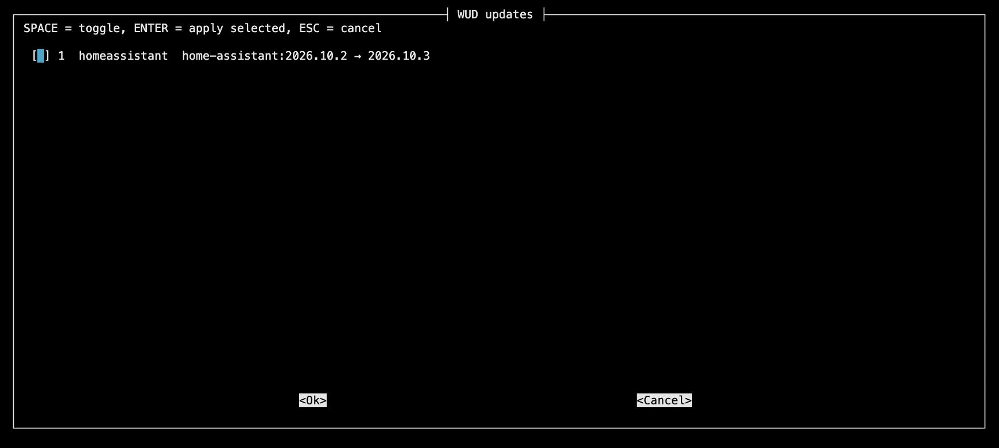

import Note from "@components/Note.astro";
import GitHubLink from "@components/GitHubLink.astro";

<GitHubLink owner="addun" repository="homelab" />

## The problem

Every service in home lab is a Docker Compose stack with a **pinned** image tag:

```yaml
services:
  immich-server:
    image: ghcr.io/immich-app/immich-server:v3.3.5
    # rest of config

  homeassistant:
    image: ghcr.io/home-assistant/home-assistant:2026.10.2
    # rest of config

  grafana:
    image: grafana/grafana:13.2.4
    # rest of config
```

Now, to get info about new version, I would have to manually check each image's repository for updates.
With ~40 containers across a many different compose files, "check for updates" means visiting a dozen GitHub release pages.

## Potential solutions

The usual answer is [Watchtower](https://containrrr.dev/watchtower/) - a container that pulls new images and restarts containers automatically.
But that goes against the principle of pinning: I don't want my containers to update automatically. I just want to be informed about new versions.
What is more, I have no idea which version each container is currently running without inspecting the compose files or querying the Docker daemon.

Also there are problems with breaking changes: if an image updates automatically, it might introduce changes that are incompatible with my setup.
At the end, backup strategy is the critical part: if an image updates automatically and breaks something, I need a way to roll back to a known good state.

## Human-in-the-loop approach

The idea is to have a system that monitors for updates but leaves the decision-making to the human operator.
This way, I can stay informed about new versions without risking automatic updates that might break my setup.

The expected solution is to have a tool that continuously monitors the Docker environment for updates and reports them, while leaving the actual update process to the human operator.
Because I am using pinned tags for my containers (in docker-compose files), I need a tool that can detect updates and can apply them automatically to the compose files, but only when I decide to do so.

## What WUD is

After some research and experimentation, I found that WUD perfectly fits the human-in-the-loop approach I described above.

[WUD](https://getwud.github.io/wud/) (What's Up Docker, [source on GitHub](https://github.com/getwud/wud)) is a single container that:

- **Watches** the Docker daemon through the socket and lists every running container with its image and tag.
- **Looks up** each image in its registry (Docker Hub, GHCR, LSCR, Quay and many more are built in) and compares the running tag with the tags available upstream.
- **Reports** the result through a REST API, and optionally through triggers - SMTP, Slack, Telegram, MQTT and others.

The important part is what it _doesn't_ do by default: it never pulls, never restarts, never edits a file. It only detects.
For a pinned-tag setup that's exactly the right split.

## The setup

Following the convention from the [earlier parts of this series](/blog/Pv9Kc2), it gets its own folder with its own `docker-compose.yml`:

```yaml
services:
  wud:
    container_name: wud
    image: getwud/wud:9.5.0
    volumes:
      - /var/run/docker.sock:/var/run/docker.sock:ro
      - ./wud/store:/store
    restart: unless-stopped
    environment:
      - WUD_WATCHER_LOCAL_CRON=0 6 * * *
      - WUD_AUTH_ADMIN_USER=${WUD_ADMIN_USER}
      - WUD_AUTH_ADMIN_PASSWORD=${WUD_ADMIN_PASSWORD}
```

## What it looks like in practice

Start the stack and WUD lists every container on the host with its current tag, flagging the ones with a newer version available.
The data is exposed through the API, which is what the rest of this post builds on.
A trimmed response for one container that has an update pending:

```json
{
  "name": "homeassistant",
  "watcher": "local",
  "updateAvailable": true,
  "updateKind": {
    "kind": "tag",
    "localValue": "2026.10.2",
    "remoteValue": "2026.10.3",
    "semverDiff": "patch"
  },
  "image": {
    "name": "homeassistant/home-assistant",
    "tag": { "value": "2026.10.2", "semver": true }
  },
  "result": { "tag": "2026.10.3" },
  "labels": {
    "com.docker.compose.service": "homeassistant",
    "com.docker.compose.project.config_files": "smart-home/docker-compose.yml"
  }
}
```

Two parts of that response worth to mention:

- `updateKind.semverDiff` says how big the jump is - `patch`, `minor` or `major`. That's the number that decides whether I read release notes first.
- `labels` contains the `com.docker.compose.*` labels that Docker Compose attaches to every container it creates. They hold the **exact path of the compose file** that created the container. That's a free mapping from "this container is outdated" to "this is the file to edit".

## Omit pre-release tags

Out of the box WUD recommends the newest tag it can find, and registries are full of tags that aren't releases: `dev`, `rc`, `nightly`, `-ubuntu` variants, an `immich` tag with an `-openvino` suffix. Two labels on the container filter them at the source:

```yaml
portainer:
  image: portainer/portainer-ce:2.45.3-alpine
  labels:
    # Only track the -alpine variant; ignore plain tags like 2.42.0.
    - wud.tag.include=^\d+\.\d+\.\d+-alpine$$

immich-machine-learning:
  image: ghcr.io/immich-app/immich-machine-learning:v3.3.5-openvino
  labels:
    # track only the -openvino variant; ignore plain tags like v3.3.5.
    - wud.tag.include=^v\d+\.\d+\.\d+-openvino$$
```

`wud.tag.include` is a regex that a tag has to match to be considered, and `wud.tag.exclude` removes tags that match.

<Note type="HELPFUL">
  The doubled `$$` is Compose escaping, not part of the regex. Compose treats a single `$` as the start of a variable,
  so `$$` is how you write a literal `$` in a label value. Inside the container the regex ends with a plain `$`.
</Note>

## From "update available" to a compose diff

Now the problem is half solved. I don't want automatic updates and I don't want `latest` (or any floating tag), so the only way to apply an update is to **bump the version in the compose file myself**. The flow is simple:

1. Ask WUD what is out of date.
2. Based on the response, bump the version in the right compose file.

With ~40 containers that is a long, boring job, and the kind of thing that stops happening.
So I wrote a script that does it. It's a small Bash script (`jq`, `curl`, `perl`) that lives in the same repository as the compose files, and it does exactly this:

1. **Asks the WUD API** for the list of containers.
2. **For every outdated one**, finds the compose file, the service and the old version.
3. **Replaces the old version with the new one** in that file.
4. **Prints the command to deploy the change** - it never pulls images or restarts anything.

```
🔎 Querying WUD ...

📦 Updates available:
     #  CONTAINER              FILE                               CHANGE
     1  homeassistant          smart-home/docker-compose.yml      home-assistant:2026.10.2  →  home-assistant:2026.10.3
```

That's real output from the server. As you can see, it lists the container, the compose file, and the change from the old tag to the new one.
What is more I can run interactive updates with the script, selecting which updates to apply and which to skip.



<Note type="HELPFUL">
  The script can be run with flag `--dry-run` to show only the list of updates without applying them.
</Note>

<Note type="HELPFUL">
Because the whole `apps` folder is a git repository, the result is an ordinary diff - that's the review step:

```
Review first with:  git diff -- '*docker-compose*'

🚀 To pull and redeploy the updated services:
   docker compose -f "smart-home/docker-compose.yml" up -d --pull always homeassistant
```

</Note>

If the changes look fine, I run the printed `docker compose` command, check that the service came back healthy and commit.

## The final solution

- Every day at 06:00, WUD scans the host and updates its list of available container updates.
- **When I have a few minutes** - I run the script to check for available updates and apply them selectively.
- **Run back-ups if necessary** - Before applying updates, ensure that I have recent backups.
- **After applying updates** - I review the changes, run the necessary `docker compose` commands, and commit the updates to the repository.
